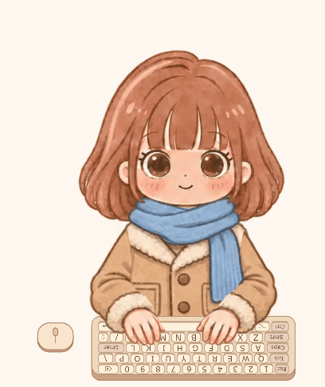
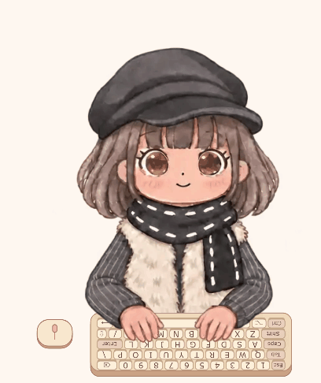
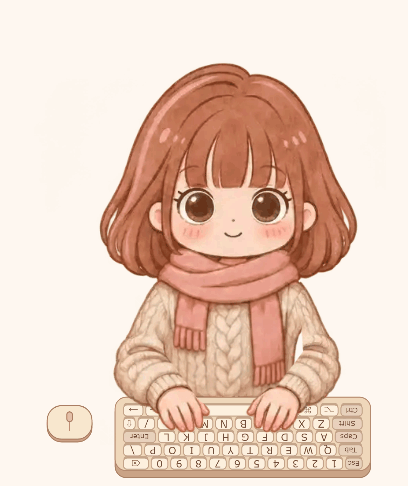
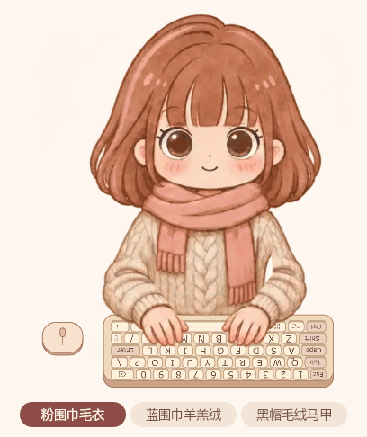

# AA TYPING

> **你敲第一个字，她跟着敲。你一口气敲十下，她就开始瞪你。**

**AA** 是住在 Mac 桌面上的水彩小女孩。她有一把自己的小键盘。你按下哪个键，她就伸手去敲哪个键，字母还会从她头顶蹦出来。把鼠标移到她头上，她会眯起眼睛，摇两下脑袋。

[**把 AA 带回桌面 · 下载 2.1.1**](https://github.com/aaaa0718/anan-typing-pet/releases/download/v2.1.1/AA-TYPING-macOS-arm64-2.1.1.zip) · [安装说明](#安装) · [更新记录](https://github.com/aaaa0718/anan-typing-pet/releases)

适用于搭载 Apple 芯片的 Mac，系统需为 macOS 13 或更新版本。

## 🎬 看看 AA 的桌面日常

| ⌨️ 「怎么还在打字呀！」 | 🖱️ 「鼠标我也会用」 |
| :---: | :---: |
|  |  |
| 5 秒内敲 10 下，字母还在往上蹦，她的眉头已经皱起来了。 | 你一挪鼠标，她也伸手握住自己的小鼠标，跟着滑动。 |
| **☁️ 被摸头了** | **💤 先打个盹** |
|  |  |
| 鼠标停在头顶，她会笑眯眯地晃晃脑袋。 | 键鼠安静 30 秒，她就叠着手打盹。你一动，她又醒了。 |

四段 GIF 取自 2.1.1 的角色动画。打盹片段跳过了等待时间。想亲自试试，可以下载 [浏览器预览文件](source/preview.html)，打开后点进输入框敲几下。

## 给 AA 换身衣服



**粉围巾毛衣**是她的原装，**蓝围巾羊羔绒**把她裹得暖暖的，**黑帽毛绒马甲**还搭了一头灰棕色短发。右键点 AA，打开「换装」就能选。

## 安装

1. [下载 2.1.1 安装包](https://github.com/aaaa0718/anan-typing-pet/releases/download/v2.1.1/AA-TYPING-macOS-arm64-2.1.1.zip)，解压后把 **AA TYPING.app** 拖进「应用程序」并打开。
2. 前往「系统设置 → 隐私与安全性 → 输入监控」，开启 **AA TYPING**，然后重新启动应用。这样她就能在你切到其他应用打字时跟上。
3. 右键点击 AA，或从菜单栏的键盘图标打开设置。

安装包使用临时签名，未经 Apple 公证。已通过编译、签名和动画检查，尚未在其他 Mac 上验证安装及全局输入。[查看 2.1.1 发布说明](https://github.com/aaaa0718/anan-typing-pet/releases/tag/v2.1.1)

## 输入权限与隐私

应用读取物理按键的键位来驱动动画，不保存打字历史。macOS 启用安全输入时，AA 会暂停按键动画。需要暂时关闭键鼠互动时，可以从菜单选择「暂停联动」。

## 从源码构建

需要 Xcode Command Line Tools 和 Python 3。在仓库根目录运行：

```sh
python3 source/build.py
```

构建产物在 `dist/AA TYPING.app`。原生 macOS 宿主在 [source/main.swift](source/main.swift)，角色素材和动画在 [source/preview.html](source/preview.html)。`runtime/` 和 `snapshot.json` 保留了 2.0.0 的历史安装版本。
